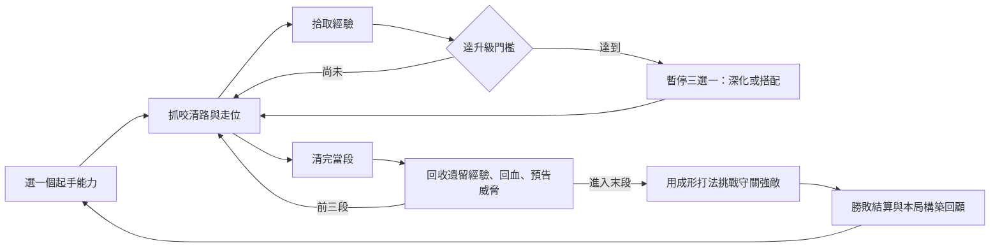

# 奈奈 v0.17：局內成長與構築回報提案

**Status:** implemented · **Updated:** 2026-11-18。使用者已核准 R1 並要求實作；已產出 v0.17，真人手機試玩與樂趣驗收待完成。

**修訂：R1（review 後）。** 普通追兵全局固定血量、提早最後一次成長、守關支援改為血量門檻、A 實際受傷斷連擊，並補齊雙手輸入重置。使用者於 2026-11-18 確認開始實作；數值仍需真人試玩校準。

這是下一個可玩里程碑的推薦規格，不是正式版完整規模。目前可玩版本見 [v0.17 試玩說明](../development/nana-v0.17-practice.md)。本文新規則的起始數值均為 **[ASSUMPTION] 設計假設**；仍需真人實玩校準。

## 1. 要回答的問題

使用者已確認操作順，v0.16 疾追者能迫使走位和使用大絕；最新回饋仍是重玩吸引力不足，缺少目標、成就感與回饋感。這不等於戰鬥樂趣或難度已驗收通過。

目前短局的擊殺不掉經驗，成長集中在過段選單，最多兩個二級能力。開發判斷：戰鬥成果與成長缺乏持續連結，成形幅度及每局發展空間有限。這是待驗證的原因假設，不能宣稱加入經驗與隨機就必然好玩。

**本輪體驗目標：操控黑貓奈奈抓咬清路，回收戰果，親手養成一套有感的打法，再用它擊敗守關強敵。**

目標玩家延續手機橫向雙手操作、短局生存與構築實驗的既有方向；精確客群尚未定案。首次試玩不要求記技能樹或精準操作多個技能按鈕。

## 2. 整體玩法架構

| 尺度 | 玩家目標 | 選擇及回報 |
| --- | --- | --- |
| 數秒 | 清出路線、避開預警、處理疾追者 | 決定接敵、撤退或開大絕；取得空間與掉落 |
| 十幾至數十秒 | 湊到下一次升級 | 回收戰果，決定深化核心、增加能力或補生存 |
| 一整局 | 養成打法並擊敗守關者 | 用前段投資處理後段壓力，看到明確的戰力與操作變化 |
| 下一局 | 實現另一個打法，或修正上局投資 | 起手自主選擇，後續機會有限變化；本輪不提供永久數值養成 |

保留一張場地、四段與現有輸入。正式十分鐘、新地圖、新角色及完整 Boss 系統不在本輪。

## 3. 四段流程與勝敗

| 段落 | 作用 | 成長與挑戰目標 |
| --- | --- | --- |
| 1 清路 | 認識起手能力、開始累積 | 第一個核心進階有機會取得；普通怪可快速清除，疾追者仍需應對 |
| 2 混合威脅 | 判斷深化還是增加第二核心 | 投擲者、衝撞者要求換目標；開始看到不同投資的取捨 |
| 3 追擊與清路 | 讓本局主打法成形並有時間使用 | 中後段有機會取得最後一次升級，之後用現有疾追者、守衛及混合追兵檢驗成長 |
| 4 守關 | 檢驗已養成的打法 | 重點為擊敗守關者；支援怪製造清路與集火的取捨 |

- 前三段沿用 v0.16 的有限波次、敵人種類、數量與安全出生規則；**普通追逐者四段皆為 18 血**，取消第三段 32 血及第四段 26 血的覆寫。疾追者維持 48 血，其餘敵人沿用既有數值。清完已排入的敵人及波次才過段，不因玩家升級即時增加敵人生命。
- 普通追兵負責提供可明顯清除的戰果；較耐打的疾追者及守衛承擔追擊與集中處理的壓力。先維持既有數量，不因取消厚血立刻增加敵量；若真人成形後完全沒有判斷需求，再調整既有威脅的組合。
- 前三段沿用每段 75 秒戰鬥時限；末段 90 秒。整局有效戰鬥時間目標約 3–5 分鐘，讀選項與休息時間另計。這是節奏目標，不保證最低局長。
- 段間沿用回血 25、上限依本局最大生命；**移除免費段間能力升級與替換**。玩家的每次強化來自經驗升級。
- 過段自動收回地面剩餘經驗，先處理待選升級，再顯示休息與下一段威脅。沒有經驗掉在上一段而永久遺失的問題。
- 末段守關者使用現有精英攻擊流程與預警，生命起始提案為 900；名稱與血條標明「守關者」。不新增攻擊招式或美術製作線。
- 末段 0 秒排入守關者與 6 隻普通追兵，6 秒排入 1 投擲者。守關者生命首次降至最大值的 66%／33% 以下或等於門檻時，各排入 **2 疾追者＋4 普通追兵**；每個門檻限一次，取代初稿的 10／18／26 秒定時支援，不與舊支援疊加。
- 門檻支援使用既有出生預警、安全距離與容量限制，不直接生成在玩家身上；HUD 門檻刻度與短提示標示支援到來。一筆傷害跨過兩個門檻時，依高至低排隊，兩批開始預警至少相隔 2 秒，不額外加入鎖血或無敵。守關者死亡就取消未出生支援，不為強制展示波次而延後勝利。
- 上述時點是排入出生預警的時點，實際出生仍受安全檢查影響。門檻已觸發但等待安全位置或容量時，保留待排狀態，不重複觸發。
- **守關者死亡且奈奈存活即勝利**，取消未出生支援並停止其餘敵人，不再等下一批或要求清空全部小怪。同一更新內奈奈死亡優先判失敗；死亡或達時限未完成目標均結束本局。
- 900 血先保留為測試起點，約 25–45 秒僅作初始節奏觀察窗，不要求各打法同時長。先檢查不同構築的通關、清路、受傷與大絕使用；高單體輸出較快擊敗守關者可以是投資回報，不以增加血量抹平差異。若有打法在支援尚能形成壓力前就穩定結束，再檢查整個遭遇與能力收益，不只拉長血條。

## 4. 唯一成長資源：經驗

| 項目 | 起始提案 |
| --- | --- |
| 起始 | 角色 Lv.1，自選 A／B／C 其中一個一級核心 |
| 升級次數 | 最多 6 次，角色最高 Lv.7；每次選一項立即生效 |
| 各次所需經驗 | 12、20、28、32、40、44；累積共 176 |
| 普通追兵 | 每隻 1 經驗 |
| 疾追者 | 每隻 3 經驗 |
| 衝撞者／投擲者 | 每隻 4 經驗 |
| 守衛 | 每隻 6 經驗 |
| 守關者 | 擊敗即結算，不依賴其掉落達成構築 |
| 拾取 | 沿用靠近 100 單位吸引、420 單位／秒移動、距離小於 24 單位收取 |

- 擊殺在原地生成經驗；不要求多按拾取按鈕，不增加金幣、商店或第二種資源。
- 經驗、等級、已選強化跨段保留；升級扣除門檻後保留溢出，連續達標就依序選擇，不丟失第二次升級。
- 預期第一段約兩次升級、後兩段完成剩餘升級；實際時點由擊殺與拾取決定。首升目標約 10–20 秒，首次核心進階應能在第一段內取得，是否選它由玩家決定。
- 前三段靜態經驗預算仍為 58＋70＋72＝200；需求 176，留下 24 點，即總預算的 **12%** 餘裕。這不是實際掉落或升級時間的驗證；實作時仍須核對出生、擊殺、地面拾取與過段回收總帳，不以免費補送能力掩蓋遺失。
- 累積升級門檻為 12／32／60／92／132／176。按現行排程、前兩段完整回收且第三段及時擊殺拾取時，第 21 秒那批已可讓總預算達 178，最後一次升級有機會在末批 36 秒之前取得；實際仍受出生重試、擊殺與拾取影響，需記錄升級時點。
- 最後一次升級目標在第三段中後期，讓玩家先使用成形打法再進守關；若回收較晚，允許在第三段結束時取得，視為進守關前的最後準備。段末自動回收仍保留，不要求逐顆完美拾取。前三段任一段逾時即失敗，不能把「沒清完卻繼續下一段」當作經驗餘裕的驗證情境；安全出生重試也不得靜默吞掉經驗預算。
- 到 Lv.7 後停止升級選單；既有地面經驗仍可收取並計入紀錄，HUD 改顯示「構築完成」。末段以突破守關者為主要回報，不再依賴連續跳出升級。
- 升級不自動回血；若選生存強化，按其規則處理。生命歸零時不開升級選單、不能藉待選強化復活。

## 5. 構築容量與選項規則

**每局最多兩個核心、最多一個核心升到三級。** 核心等級與角色等級分開顯示。第二核心不是必選；增加核心、深化與共通強化都消耗一次升級機會。

選擇原則是「我這局要如何長大」，不再要求玩家為了下一段反覆替換能力。本輪不提供替換與退點；卡片需預告核心後續效果與兩格限制，避免不知情地鎖住發展。

### 5.1 核心發展表

下表是同一套升級內容；每次只升一級。未特別改動的命中判定、重咬鎖定、大絕及 B＋C 規則沿用 v0.16，詳細參照 [v0.13](../development/nana-v0.13-practice.md) 與 [v0.16](../development/nana-v0.16-practice.md)。

| 核心 | 一級：入口，沿用現行 | 二級：深化提案 | 三級：本局成形提案 |
| --- | --- | --- | --- |
| A 穿影爪 | 有效爪擊命中三次，發出一道長 340、寬 90、傷害 8 的爪影 | 改為連擊累積：連續爪影基礎傷害為 8→12→16，上限 16；兩次有效爪擊間隔超過 1.2 秒，或奈奈實際受到傷害，進度與威力重置。移除現有二級的後方爪影 | 威力達第三檔時，爪影寬度增至 180，長度不變；中斷即回到窄爪影。維持接敵並避開傷害，才能維持遠端清路範圍 |
| B 游走蓄勢 | 停止攻擊並實際移動 260 單位，取得一次傷害 22、距離 175、全角 180° 的蓄勢爪；空揮保留 | 沿用命中存活非獵痕目標時，額外推開 65 單位；保留對獵痕目標的例外 | 最多存兩發，每 260 單位取得一發；每次命中消耗一發，能連續兩次爆發。攻擊期間仍不累積移動蓄勢 |
| C 獵痕重咬 | 沿用永久獵痕、命中加速蓄咬、重咬兌現；死亡／轉移／兌現清痕 | 沿用兌現時，對半徑 110 內其他敵人造成 8 傷害 | 兌現後若原目標存活，保留其獵痕；下一口仍須完成原本的蓄咬與出手，不能立即追加或自動轉向。聚焦同一強敵可連續兌現 |

- A 的連擊時鐘只由普通／蓄勢爪實際命中更新，每次出手最多計一次；爪影、重咬、波及與大絕衝擊不刷新、不自我觸發。A 的爪影仍延遲 0.12 秒，取出手位置與方向，同一道每敵只命中一次。寬度及傷害採該道爪影產生時的連擊檔位。
- A 二級以上只有實際 HP 減少才觸發受傷重置；被無敵擋下的碰撞／攻擊不重置。重置只影響 A 的三次命中進度與威力，不清除蓄咬或 B 存量，不取消已產生且採快照的待發爪影；一級規則沿用現行。用威力指示退回第一檔表達，不新增額外僵直或扣除資源。
- B 三級使用「已存發數＋不足一發的移動進度」；消耗一發保留剩餘進度，滿兩發後不繼續囤積距離。同次多目標只消耗一發，範圍命中不返還蓄勢。
- C 三級僅在兌現傷害後目標仍存活時保痕；死亡清除，咬中其他目標照原規則轉移。C 二級波及不留痕、不蓄咬、不觸發另一輪兌現。C 三級不額外贈送蓄咬格。
- 保留 B＋C 的既有回報：蓄勢爪命中仍存活的獵痕目標，可為**下一次**出手蓄滿重咬。B 三級只增加儲存，不增加單次贈送次數。
- A 偏維持連擊、B 偏撤退後爆發、C 偏集中強敵。A＋B 允許共存，不額外新增強制協同；維持連擊與長時間退開仍有取捨。
- 所有追加傷害均不得遞迴觸發其他追加傷害。既有大絕對爪擊、B 蓄勢與 C 重咬的倍率保留；不因三級效果免費刷新大絕或增加無敵。

### 5.2 共通強化與選擇成本

小池共三個核心入口、六個核心進階與以下三個共通項目，合計 **12 種項目**；不做稀有度。每個共通項目最多選兩次。

| 項目 | 每次效果 | 與核心進階的取捨 |
| --- | --- | --- |
| 利爪 | 全部奈奈攻擊傷害 +10%，同項線性累加、最多 +20%，每筆傷害只套一次 | 穩定提高所有已裝能力，放棄一次行為進階機會 |
| 伸展 | 爪擊、重咬距離及爪影長度 +10%，同項最多 +20%；不增加角度、寬度或兌現波及半徑 | 更容易安全接敵，收益取決於位置及既有能力 |
| 護身 | 最大生命 +15，當前生命同增 15 並受新上限限制 | 即時容錯，放棄一次輸出或核心成形投資 |

利爪先形成獨立共通倍率，再與既有大絕倍率相乘；不改變大絕適用來源。伸展也作用於 B 的 175 距離，不以固定蓄勢距離覆蓋共通加成。

### 5.3 受限隨機與保底

1. 開局自行選 A／B／C，一級能力立即可用；本輪不隨機指定起手打法。
2. 每次升級提供三個不同、可立即選用的項目。剔除滿級、滿格的新核心、共通已達上限，以及已取得另一三級核心後的三級項目。
3. 有合法的已裝核心下一級時，**至少一格提供進階**；兩個核心競爭時輪替優先，不讓同一核心連續兩次升級都沒有出現合法進階。
4. 尚有核心空格時，至少一格從未裝的核心隨機抽取；其餘從合法共通項目隨機補齊。核心滿格時該格也改抽共通項目；共通候選不足時以其他合法核心進階補足。同張卡不得重複占格。
5. 三級從角色 Lv.4 的那次選擇起才合法，且必須已取得該核心二級。核心進階保底提供機會，不替玩家自動選擇，也不保證所有錯誤投資都能通關。
6. 依上述六次投資與項目上限，實作前／測試時遍歷可達狀態，確認每次都有三項合法選擇；若有缺口，先修規則，不塞入無效或無限小數值卡。
7. 候選使用獨立種子，與敵人出生及安全位置分開。保留每次候選及選擇，能重播相同機會序列；玩家行為仍可能讓實際接敵不同。
8. 本輪不加重抽貨幣、保留卡庫或商店。兩個未選項在這次選擇結束後消失，之後仍可依合法條件再次出現。

可形成的例子：A3＋共通強化，偏維持連擊清路；B3＋C2，偏兩次切入與獵痕兌現；C3＋A2，偏集中強敵並維持側向清路。這些都是預期打法，尚未證實強度或趣味。

## 6. 回饋、目標與結算

| 時點 | 必須看懂或感受到的資訊 |
| --- | --- |
| 開局 | 「四段森林挑戰／擊敗守關者」；起手能力一句話與後續發展預覽 |
| 擊殺／拾取 | 可辨識的掉落、吸入軌跡、短音效、經驗條實際前進；大量同時拾取合併播放，避免每顆反覆提示 |
| 升級 | 凍結戰鬥；卡片以一個短句說行為改變，附關鍵數值與等級；占格／三級限制保持可見，後續等級預覽按詳情才展開 |
| 選定 | 短確認效果，回到戰鬥立即生效；左右兩手均清除舊觸控 ID、拖曳向量及攻擊狀態，重新觸碰後才恢復移動或攻擊 |
| 核心成形 | 三級取得時清楚宣告一次；A 用爪影威力檔與寬度、B 用兩格存量、C 用兌現後保痕來顯示實際變化 |
| 段間 | 本段完成、回血量、下一段主要威脅；顯示本局構築，沒有另一套免費升級 |
| 末段 | 守關者具名血條；目標明確為擊敗它，不顯示誤導性的「還剩幾隻才贏」 |
| 結算 | 勝敗、通過段數、實際持有的核心與共通強化、取得順序，以及一項能對應本局打法的成果 |

成果從實際事件取值，例如爪影命中數／蓄勢有效出手數／獵痕兌現數；有取得三級且有實際觸發才顯示其成果。不同指標不合成虛構綜合評分，不顯示未證實的「變強百分比」。

段間預告主要幫玩家準備下一段的站位、選敵與大絕時機；段間沒有新投資選項，不把預告本身當作一次構築決策。六次升級與三次段間最多形成九個停頓節點，與段末升級相鄰時接續呈現，不額外增加一次確認對話；觀察真人選卡耗時及戰鬥是否被切碎。

失敗可顯示最後傷害來源與當時進度；不武斷推論唯一死因或宣稱哪一張卡必勝。提供「同一起手再試」與「換起手」；前者開新候選種子，測試用同種子重播留在開發工具。

這輪包含經驗拾取、升級、核心成形及守關者倒下的必要視覺／短音效。正式角色動畫、全套音效、背景故事與震動整合可後置；敵人預警始終優先於能力特效。

## 7. 狀態與程式責任邊界

沿用 Godot 與現有模組，分清楚三種狀態即可；本輪不建立通用卡牌框架或全面重構戰鬥。

| 責任 | 狀態及規則 | 現行落點／預期調整 |
| --- | --- | --- |
| 整局流程 | 段數、生命、冷卻、等級、經驗、構築、候選種子、決策與結果 | [nana_series.gd](../../game/scripts/nana_series.gd)；明確保留局內共同狀態，不能每段重設等級與投資 |
| 成長規則 | 經驗門檻、核心／共通項目、合法候選與保底 | [nana_growth_run.gd](../../game/scripts/nana_growth_run.gd)；資料與選擇規則共用，UI 不自行計算升級效果 |
| 場內世界 | 本段敵人、預警、地面掉落、計時、碰撞及升級狀態 | [run_model.gd](../../game/scripts/run_model.gd)、[nana_experiment.gd](../../game/scripts/nana_experiment.gd)；新短局使用本文規則，不重啟舊掃群／狩獵專精流程 |
| 能力執行 | 爪擊、爪影、蓄勢、獵痕、大絕與傷害來源 | [nana_combat.gd](../../game/scripts/nana_combat.gd)；讀取本局構築，維持不遞迴的追加效果邊界 |
| 呈現與輸入 | HUD、升級、休息、結算及重試 | [main.gd](../../game/scripts/main.gd)；讀規則結果、送出選擇，不持有第二份成長狀態 |

- 升級、休息、背景暫停凍結敵人、出生、冷卻、能力與時限。選卡不應偷跑世界或讓玩家被待發攻擊擊中。
- 進出升級、休息與暫停時清除雙手輸入；舊手指的後續拖曳／放開不重新取得控制，須新的按下事件。桌面按住移動鍵／攻擊鍵時也須先放開再按，避免離開選單後沿用舊輸入。
- 過段保留 HP、最大 HP、冷卻、剩餘大絕、蓄咬、B 存量與距離；A 連擊及爪影威力重置，C 獵痕與指向上段敵人的待發攻擊清除。新段敵人 ID 不得誤接舊獵痕。
- 不在戰鬥中的時間不計入有效戰鬥局長；選卡耗時另記，避免讀選項很久被誤認為戰鬥變長。
- 死亡／重試清空本局成長及未結算效果；下一局從 Lv.1 開始。只保存本機測試紀錄，不做續局存檔或永久屬性。
- 現行固定能力實驗保留作開發對照；玩家主要入口指向新短局，避免在主畫面新增多個定位重複的正式模式。

## 8. 核准後的交付順序

| 步驟 | 範圍 | 判斷下一步的依據 |
| --- | --- | --- |
| 1 接回成長 | 掉落、拾取、跨段經驗、六次選擇及保底；先用固定候選序列做開發檢查 | 擊殺確實帶來成長，升級不丟失，前三段資源足夠 |
| 2 做出成形 | 三個核心發展、共通選擇、必要回饋；依序完成以便隔離問題 | 至少 A、B 兩條能在相同遭遇下展示不同成形行為；C 的沿用與新邊界正確 |
| 3 接完整一局 | 守關者勝敗、休息及結算；開啟受限隨機 | 同一套內容可測規劃與隨機，沒有用新增敵人冒充隨機的收益 |
| 4 真人試玩收斂 | 交付一個完整測試版本；記錄期待、取得、使用、重玩四個時點 | 判斷成長是否讓戰鬥更值得投入，再決定擴充內容或局外進度 |

使用者已要求實作；上述步驟已整合交付 v0.17，真人試玩與調整待進行。

## 9. 驗收與停損

提案自查已用暫存模型遍歷六次投資的可達狀態，合法項目總數均至少三個；這不代表實作後的抽選、輪替保底或介面已通過測試。經驗預算同樣只有上節的靜態核算。規則驗收由開發端負責，以下目前均未驗證：

- [ ] 普通追兵四段皆 18 血；經驗不重複、不遺失，溢出、過段回收與連續升級正確；記錄最後升級時點及可用成形打法的戰鬥時間。（未驗證：待實作）
- [ ] 遍歷六次投資的可達狀態，滿格／滿級／三級互斥、候選三項與進階保底皆成立。（未驗證：待實作）
- [ ] A 的未命中超時／實際扣血重置、無敵未扣血保留、待發爪影快照符合規則；B 兩發與部分進度、C 保痕／死亡／轉移、B＋C 互動正確，額外傷害不遞迴。（未驗證：待實作）
- [ ] 升級及段間不推進世界；雙手舊觸控不延續到戰鬥，跨段、死亡、重試不殘留舊目標或投資。（未驗證：待實作）
- [ ] 守關血量門檻每段只觸發一次；跨兩門檻不瞬間疊出生，保留完整預警與安全出生；守關者擊敗立即結算、取消支援，死亡與時限判定可重現。（未驗證：待實作）

守關比較用相同六次投資額度，至少涵蓋 A3、B3、C3 主核心與含／不含 C 的搭配；記錄入場 HP、守關者出生至擊敗時間、支援觸發與實際出生時間、受傷、大絕及結果，保留各配置結果和時間差，不只報平均。固定站樁 DPS 用來查異常，不能替代完整遭遇及真人節奏判斷；不要求不同路線同樣快，也不以紙面單體 DPS 宣稱 C 是唯一解。

真人驗收以兩次不同起手的自然遊玩為建議樣本，不以兩場結果推論普遍留存：

- 第一段內是否感受到擊殺讓下一次成長接近；紀錄首升時間，不把預期時點當成實測。
- 取得關鍵強化後，玩家能指出至少一次實際改變的接敵、清路或集火方式；單純看卡片說「比較強」不足。
- 末段前至少有一次期待某個強化的時刻，取得後願意立即試用；若玩家刻意不投資核心則另外記錄原因。
- 結束後能指出本局選擇的成果，並自然提出想嘗試的另一條發展或修正；單純因被要求測另一個起手不算重玩意願。
- 手機上能看清經驗、升級與能力狀態，不遮住疾追者及特殊敵人的預警。

**停損判準：**若玩家只在開選單時有興趣，回到場上仍然無聊，優先檢查能力如何改變接敵與清怪；若成長有感但每局相同，下一步再擴充少量可組合選項；若每局本身有趣但缺長期目標，再討論局外解鎖。不直接把三種問題一起轉成新系統。

## 10. 主要取捨與暫緩事項

| 議題 | 本輪推薦與理由 |
| --- | --- |
| 戰鬥中升級或全留段間 | 採拾取升級、暫停選擇；讓擊殺連到近期目標。以六次額度限制中斷，觀察是否切碎戰鬥 |
| 全隨機或完整指定 | 自選起手、進階保底、第二核心與共通有限隨機；保留控制感並測試不同機會 |
| 兩個三級核心或一個 | 限一個；讓深化主打法與廣泛投資有成本。若限制只造成挫折，再依試玩調整 |
| 局外資源延續 | 後置；先驗證單局獲得、選擇與使用的樂趣。之後優先評估擴充選擇的解鎖，再評估永久數值 |
| 繼續加壓或擴大內容 | 暫停單獨加難度。只校準新成長所需的資源與守關挑戰，不延長成六段或增加敵種 |
| 成就、每日、收藏、劇情 | 記錄為後續候選。本輪以可觀察的戰鬥成果與終局突破提供回報 |

本輪仍有風險：A 受傷歸零可能造成受傷後更難清路的連鎖挫折、B 兩發可能不足以補停手成本、C 可能一直兌現過強；共通數值也可能變成唯一正解。先檢查是否抹平打法、阻礙成形或讓成長無感，其餘局部倍率留待相關迭代。同一起手的選項變化有限屬已知範圍限制，本輪先觀察，不立即擴大牌池。

## 11. 決策狀態與依據

| 狀態 | 內容 | 依據 |
| --- | --- | --- |
| 已確認 | 聚焦奈奈、手機雙手操作、抓咬與主動大絕；沿主線小步實玩，優先處理影響方向的問題 | [開發路線](development-roadmap.md)、[回饋紀錄](poc-feedback-and-followups.md) |
| 已確認 | R1 經使用者確認開始實作 | 2026-11-18 使用者指示 |
| 已實作，待試玩 | 本文成長資源、四段流程、三級構築、受限隨機與守關者 | v0.17 程式與 APK；未通過真人驗收 |

研究僅沿用 [既有隨機構築可行性分析](../research/random-driven-combat-mode-feasibility-2026-11-14.md)：可理解的機會、投資與共用內容對照。本文選擇重新把拾取成長接回短局，是依新版真人回饋提出的設計調整，不把歷史「段間構築」推薦當成不可變規格。

History：2026-11-17 建立首版，供使用者確認；沒有變更遊戲程式或建置版本。

### R1 review 處理紀錄（2026-11-17）

| 意見 | 判斷與修訂 |
| --- | --- |
| 厚血普通追兵抵銷成長感 | 優先處理，採全局 18 血；保留現有疾追者與守衛，不同步加量或重做利爪 |
| 經驗餘裕太小 | 優先處理，總需求降至 176，並明定最後成長時點與段末回收。初稿已有回收，問題不是要求完美拾取；前三段安全重試不等於永久取消出生，逾時則本局已失敗 |
| 守關者可能只剩長血條、C 可能過優 | 採血量門檻支援替代定時波次；保留相同投資的逐配置比較。900 血仍是測試值，紙面 DPS 尚不能證明唯一正解 |
| A 缺乏維持連擊的風險 | 加入二級以上實際受傷重置；明定無敵、待發爪影及其他資源不受影響，觀察連鎖挫折 |
| 卡片文字、雙手輸入 | 納入本輪必要規格，避免理解與操作阻礙核心驗證 |
| 牌池較小、段間預告不再直接驅動投資 | 記錄限制，先測現有範圍；明定預告是戰術資訊，不新增段間經濟 |

算式校正：review 的「利爪改 +4、兩次後一擊殺 26 血」不成立，`10＋4×2＝18`。原提案百分比利爪兩次後 B 為 `22×1.2＝26.4`，可擊敗 26 血普通追兵；普通爪擊為 12。這些只是不含重咬、爪影及大絕的單次傷害門檻，不等於完整實戰清怪速度。R1 不採用固定加傷替案。

History：2026-11-17 R1 依外部 review 修訂本文；仍待使用者確認，尚未實作或新增測試版。

History：2026-11-18 使用者核准實作 R1，完成 v0.17 原型與 Android 測試版；待真人試玩。
