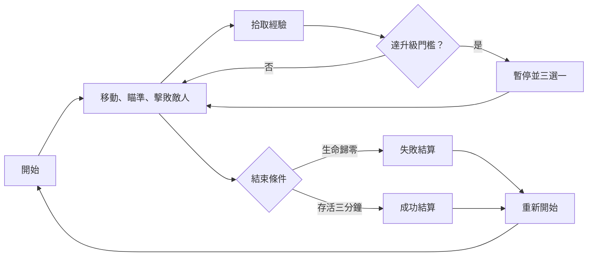

# 刺蝟生存原型 v0.1：規格草案

日期：2026-11-13。狀態：使用者已明確授權安裝並開始，Godot + GDScript 與本文實驗規則已採作原型起點。Mac 開發版本已完成首輪實作，手機驗收待辦。

## 要交付的體驗

玩家在手機橫向畫面控制可愛刺蝟，一邊走位，一邊瞄準發射尖刺。擊敗敵人、撿取經驗、升級選擇，逐步改變攻擊表現，並嘗試存活三分鐘。

原型要回答：瞄準是否舒服、清怪是否有回饋、升級是否產生可察覺的打法差異。正式遊戲約十分鐘的局長與更多動物，依本輪測試結果再展開。

## 已確認的產品範圍

| 面向 | 共識 |
| --- | --- |
| 平台 | 手機優先，iOS 與 Android 無偏好；先選一條可用的實機測試路徑 |
| 視角 | 2D 俯視角，原型使用簡單素材 |
| 角色 | 一隻刺蝟，以方向性尖刺作為基礎攻擊 |
| 輸入 | 左側移動、右側拖曳瞄準並持續攻擊，放開右側即停止攻擊 |
| 攻擊資源 | 基礎攻擊無魔力與彈藥限制；特殊能力若加入則採冷卻 |
| 場景 | 單人離線、一張小場地 |
| 成長 | 敵人掉落經驗，靠近拾取；升級暫停、三個不同選項擇一 |
| 敵人 | 先完成追逐包圍型，再加入有明顯預警、朝鎖定方向衝刺的敵人 |
| 傷害 | 生命值、受傷回饋及短暫無敵，生命歸零結算 |
| 終點 | 約三分鐘存活成功；成功或失敗後均可重新開始 |
| 表現 | 可愛動物、童話式誇張能力、非血腥退場 |
| 合作 | 使用者決定方向與手機實玩；Codex 負責規格、程式和可執行驗證；免費工具／素材優先 |

## 原型採用的實驗規則

以下內容已隨整體規格採作可調整的起始規則；平衡與主觀手感仍需實測。

### 場地、輸入與時間

- 有邊界的單一小型競技場；玩家不能走出邊界，敵人在畫面可見區外的場地合法位置生成。出生點需與玩家保留安全距離，不直接生成在角色身上。
- 原型先測手動瞄準，另保留調整靈敏度的入口；是否需要輔助瞄準，依手機測試決定。
- 兩根手指各自持有移動或瞄準控制，抬起其中一根不應中斷另一根；畫面上的選項操作不應意外觸發攻擊。
- 第一版先完成移動與主攻擊；是否加入額外主動技能按鍵，待基本操作測試後決定。
- 三分鐘指實際戰鬥時間。選升級、手動暫停、切換到背景時，計時、敵人及彈體均暫停；返回前景後由玩家確認繼續。

### 一局的結構

- 重玩重設生命、時間、經驗、升級、敵人、彈體與掉落物；原型不提供跨局能力累積。
- 前段以追逐敵人建立操作和初次升級；中段逐步加入衝刺敵人；後段提高混合壓力。生成速率與同屏上限分開調整，安排喘息。
- 三分鐘短版暫不加入 Boss；若測試顯示需要更明確的高潮，再另提方案。

### 起始升級池

先以六種升級驗證攻擊變化與三選一流程。名稱、權重、上限與幅度都是原型設計項，實作前以資料表明確定義。

| 選項 | 初步效果 | 測試問題 |
| --- | --- | --- |
| 散射 | 增加側向尖刺，調整單發傷害以控制總收益 | 覆蓋變寬，是否改變瞄準與站位？ |
| 穿透 | 尖刺可繼續穿過額外敵人 | 是否促使玩家把敵人引成線？ |
| 反彈 | 命中後可轉向附近另一個敵人 | 是否改善分散敵人的清除效率？ |
| 傷害 | 提升既有尖刺的傷害 | 與改變攻擊行為的選項是否各有選擇理由？ |
| 攻速 | 提高發射頻率 | 是否提升連續命中的回饋，同時保持畫面可讀？ |
| 移速 | 提高角色移動速度 | 生存與拾取效率能否和輸出升級形成取捨？ |

提議的組合規則：尖刺先消耗剩餘穿透次數，再消耗反彈次數；同一發尖刺不重複命中同一敵人。反彈找不到合法目標時結束，且不額外生成尖刺；散射只在初次發射時產生，避免效果無限觸發。

提議的選項規則：每次從目前可用的選項中等權抽三個不同項目；到達上限的項目退出候選池。為避免後期無法提供三個選項，傷害、攻速、移速在此短版允許重複升級；它們的公式與合理範圍須在實作前寫清楚。這只是原型抽選策略，不等於正式版成長系統。

### 回饋與結算

- 命中、敵人退場、撿經驗、升級、受傷各有可分辨的簡單回饋；尖刺與危險預警使用容易區分的形狀或顏色。
- 結算顯示成功／失敗、存活時間、擊敗數及本局所選升級，協助回想哪種構築產生了什麼效果。
- 傷害、生命、射速、移速、拾取距離、無敵時間、經驗曲線、敵人上限及生成節奏都是可調參數；不套用競品中未驗證的公式。

## 分段交付與驗收

| 里程碑 | 可測試成果 | 完成依據 |
| --- | --- | --- |
| P0 工具與最小啟動 | 選定引擎，最小空場景可在 Mac 啟動，釐清一條手機安裝測試路徑 | 確認工具版本及實際啟動結果；手機路徑可行性與尚缺條件分開記錄 |
| P1 手感 | 刺蝟移動、瞄準、發射尖刺、追逐敵人、受傷與重玩 | 桌面功能驗證及手機雙指操作；可辨認命中和受傷，放開右側停止攻擊 |
| P2 成長 | 經驗、暫停升級、三選一及攻擊行為變化 | 可觀察升級前後差異；候選合法；暫停與重玩不遺留狀態 |
| P3 三分鐘循環 | 預警衝刺、壓力變化、成功／失敗結算與重新開始 | 實際完成成功及失敗兩條路徑；手機重複遊玩並記錄效能與操作問題 |

驗證分兩種：程式與流程是否正確，可用自動檢查及操作驗證；手感與爽感需要實玩觀察。桌面啟動或自動測試通過，不等於完成手機驗收。

每輪手機測試記錄設備、版本、所選升級、受傷或停止的原因，以及最明顯的一項手感問題。暫不以少量測試宣稱玩家留存或長期耐玩性已成立。

## 技術與決策狀態

- 已採 Godot 4.7.2 標準版 + GDScript，安裝與簽章、官方 checksum 核對通過；選型依據見 [手機 2D 引擎選型](../research/mobile-2d-engine-selection.md)。
- 首個手機系統選 Android：使用者兩種手機都有，授權選較容易開始的路徑，並已明確同意 SDK 條款。工具鏈及已簽署 APK 已完成；具體裝置與實機結果仍待辦。iOS／Android 的產品優先順序仍無偏好。
- 原型採用 2600 × 1900 場地、1280 × 720 基準畫面，左半區移動、右半區瞄準；雙指取消、失焦清除輸入已接上。
- 初始數值、升級上限、傷害與射速公式、選項生成及穿透／反彈規則已在 `game/scripts/run_model.gd` 定義，精確起始公式亦見根目錄 README。
- Mac 匯入、執行、規則與場景流程已驗證；P0–P3 涉及手機的部分仍未完成。詳見 [實作狀態](../development/prototype-v0.1-status.md)。
- 正式美術、其他動物、局外養成、連線、商業模式與發布時程留待對應階段決定。

安裝引擎、SDK、匯出模板或寫入大型產物前，先依本機儲存政策解析核准的目的地；現有應用程式管理的狀態維持原位。

## 依據

- [五輪設計共識](game-direction.md)
- [分階段路線](development-roadmap.md)
- [既有機制比較](../research/popular-survival-rpg-mechanics-design-report.md)
