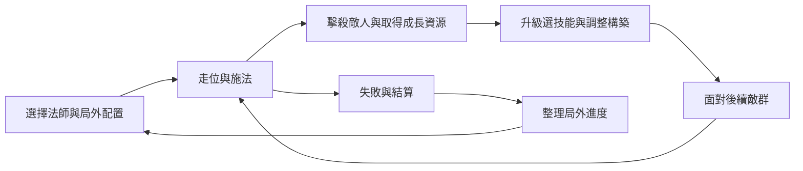
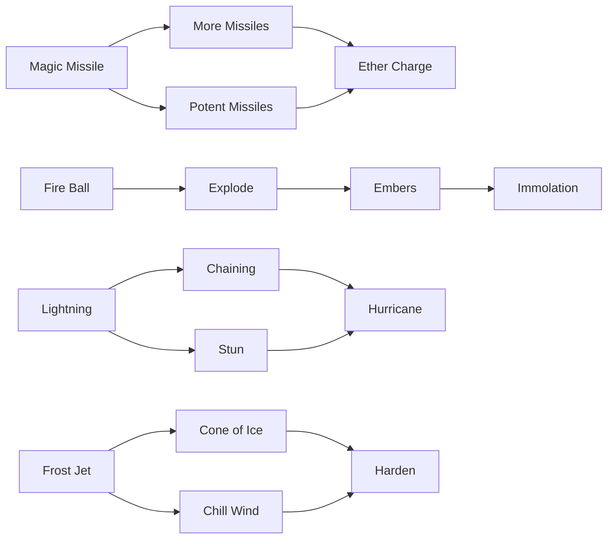

# Solomon’s Boneyard：機制設計與核心規格重點

版本範圍：使用者提供的 Android `1.3.0`，build `1049`。整理日期：2026-11-12。

用途：協助後續原創遊戲設計，整理原作資料可支持的系統與取捨。來源是 40 份解碼資料、選取 ARM64 指令與先前查閱的官方遊戲說明；目前沒有實際遊戲執行對照。

閱讀標記：**資料**＝檔案明確存在的欄位、值或顯示描述；**指令**＝靜態函式實作；**設計解讀**＝從這些證據歸納的玩法意義；**待確認**＝尚不能當成原作規格。

## 一頁重點

| 面向 | 目前能支持的設計 | 對後續開發的價值 |
| --- | --- | --- |
| 核心循環 | 官方定位雙搖桿生存射擊；戰鬥、升級選技能、面對敵群，搭配 perks 成長 | 即時操作與局內成長同時推進 |
| 攻擊差異 | 四組基礎攻擊資料：魔法飛彈、火球、閃電、冰霜噴流 | 用攻擊行為建立不同打法 |
| 技能分支 | 基礎法術具有數量、覆蓋、控場、命中效果等延伸 | 升級能改變戰鬥行為，不只修改傷害 |
| 資源策略 | 容量、回復、減耗、射速、副技能恢復各有不同資料入口 | 讓輸出能力受到持續作戰能力與操作時機約束 |
| 危急處理 | 傳送、護盾、周身凍結、範圍攻擊、地雷等顯示描述 | 提供解圍與維持安全距離的選擇 |
| 波次 | formation／敵人 flags／延遲／同屏上限／NEXT 清單分開描述 | 可以組合出壓力節奏與重玩變化 |
| 裝備 | 戒指可混合平加值、百分比、技能加值與品質標記 | 讓裝備與技能互相影響角色構築 |
| 局外成長 | 官方手機文案確認 perks 隨反覆遊玩成長 | 局內強化與跨局進度應各自定義 |

資料規模：**38 份技能檔、33 筆波次記錄、166 筆戒指記錄**。這些是資料記錄數，不代表遊戲總技能數、固定可玩波數或不重複道具數。

來源：[第一輪分析](../research/solomons-boneyard-intake.md)、[資料發現](../research/solomons-boneyard-data-findings.md)、[先前官方說明研究](../research/solomons-boneyard-rea-plan.md)。

## 1. 核心玩法循環

以下是依官方說明與資料歸納的設計圖，尚不是從程式完整還原的狀態機。

**設計解讀：** 玩家同時處理眼前的位置與攻擊問題，以及本局要發展成什麼打法。選技能、拾取範圍、移速、控場和回魔，都可能改變下一次站位與攻擊決策。

**待確認：** 升級是否暫停戰鬥、預設候選數、選項權重、經驗值曲線、死亡後各種資產保留範圍。不能只因存在 `GetThreeSkills` 函式名，就認定所有情況都固定三選一。

## 2. 四個攻擊方向與成長分支

下表功能來自 `DESC/XTRA/REQ`，是資料所描述的意圖；命中判定、攻擊頻率與傷害結算仍未完整驗證。

| 基礎法術 | 資料描述的差異 | 延伸方向 | 設計解讀 |
| --- | --- | --- | --- |
| Magic Missile 魔法飛彈 | 跟隨敵人的魔法彈 | More Missiles 增加數量；Potent Missiles 增加速度與重新選目標；Ether Charge 描述降低目標最大生命 | 強調追蹤、目標覆蓋與彈體成長 |
| Fire Ball 火球 | 投射火球 | Explode 濺射；Embers 命中產生碎片；Immolation 讓碎片也爆炸 | 用多段命中效果增加群體覆蓋 |
| Lightning 閃電 | 電弧攻擊 | Chaining 擴及更多敵人；Stun 暈眩；Hurricane 施法時產生風暴 | 讓傷害擴散與控場形成同一條成長方向 |
| Frost Jet 冰霜噴流 | 讓敵人結霜的噴流；資料檔 ID 是 `frostwail` | Cone of Ice 擴大範圍；Chill Wind 擊退；Harden 在施法時取得護甲 | 把持續施法、空間控制與防禦連在一起 |

資料中的依賴輪廓如下。箭頭表示目標技能的 REQ 提到前項，**不表示已確認多個 REQ 的 AND/OR 規則或實際解鎖流程**。

Ether Charge、Immolation、Hurricane、Harden 的 REQ 列表也都含 `level:25`。**設計解讀：** 前期先建立基本打法，後段再讓多個升級形成組合收益。實際門檻處理尚待確認。

可讀數值顯示曲線有拐點。例如火球 `DAMAGE1` 在 index 1／5／10／12／13／17 分別為 **4／18／40／50／60／100**；魔法飛彈 `DAMAGE1` 在 index 19→20 由 **19→30**。這支持研究「達到特定投資深度的獎勵」，但 index 尚不能直接視為玩家看到的等級。

來源：各 decoded 技能檔，索引與行號見 [資料發現](../research/solomons-boneyard-data-findings.md) 和 [完整技能目錄](../research/solomons-boneyard-skill-catalog.md)。

## 3. 魔力與施法節奏是獨立的成長維度

| 能力 | 資料所描述的用途 | 代表設定 | 核心區別 |
| --- | --- | --- | --- |
| Mana Up | 增加魔力容量 | `MANA_1=50`、`MANA_4=200` | 可以累積多少資源 |
| Channel Mana | 增加魔力回復率 | `REC_1=35`、`REC_4=140`；顯示模板是百分比 | 能否持續支撐輸出 |
| Battle Mage | 降低攻擊法術耗魔 | `COST_1=15`、`COST_6=80`；模板為減耗百分比 | 同一份資源可以換得多少攻擊 |
| Faster Caster | 增加射速 | `SPEED_1=10`、`SPEED_4=40`；模板為百分比 | 輸出的時間分布，也可能增加耗魔速度 |
| Meditation | 站定時回魔 | 顯示模板為 `4X`；REQ 含 `level:8` | 把位置安全與回復收益連結 |
| Mental Focus | 加快副技能恢復 | 顯示模板為 `2X`；REQ 含 `level:9` | 影響副技能恢復，並不是回魔倍率 |

這些數字是**表內設定與顯示意圖**。例如 `SPEED +10%` 不能直接寫成「冷卻減少 10%」；提升頻率與縮短間隔是不同公式。

**指令支持：** `Stats::Update()` 有一段對相同 float 欄位增加 `rate × 0.2`；`Stats::Meditate()` 在旗標成立時額外增加 `rate × 0.6`，兩者都有上界限制。若每個相同週期各執行一次，合計可對應四倍回復；但呼叫頻率、站定判定與 HUD 對應未確認，不能換算每秒數值。詳細位址見 [第一輪分析的回魔段落](../research/solomons-boneyard-intake.md)。

**設計解讀：** 提升射速、增加彈體或追加命中效果，能擴大輸出，也可能更快耗盡魔力；減耗、回復與容量因此有各自的價值。原作確切疊加順序與成本公式仍待追查。

## 4. 功能技能會影響決策方式

| 類型 | 例子與資料描述 | 可借鑑的設計問題 |
| --- | --- | --- |
| 位移與解圍 | Teleport 傳送；Flash Freeze 周身凍結；Ring of Fire 周身攻擊 | 玩家需要用什麼代價重新取得安全空間？ |
| 防禦 | Magic Shield 吸收傷害；Explosive Shield 破盾時爆炸；Resist Poison 抗毒 | 防禦能否同時參與進攻構築？ |
| 場地控制 | Magic Trap 地雷；Acid Rain 酸雨；Magic Circle 描述減速時間並強化生命／魔力 | 玩家能否創造短暫的有利區域？ |
| 選項控制 | Creativity 顯示升級選項 `+1`，REQ 含 `level:5` | 一次投資能否換取未來更穩定的技能選擇？ |
| 拾取與移動 | Telekinesis 顯示拾取 AREA `4X`；Rush 增加步行速度 | 何時讓移動、拾取效率與戰鬥強度競爭升級機會？ |

Telekinesis 的 `AREA:4X` 不能直接改寫成「半徑四倍」；原作量測與公式未確認。Magic Circle 的效果、凍結時間等也需對照各自實作，不能把顯示模板當成完整狀態規格。

## 5. 波次是有分支的資料結構

資料包含 **33 筆記錄、ID 0–30**，其中 ID 2、4 有重複記錄。NEXT 可自循環、回到前面 ID，或列多個候選；因此目前只能把它視為有分支的波次資料，不能寫成「總共 31／33 關」。

| 欄位 | 讀到的設定 | 對設計的意義／限制 |
| --- | --- | --- |
| `NEXT` | 例如 `1,2`、`25,25,25,23`、`25,24,26` | 支持後續狀態的多候選表示；機率、去重規則未知 |
| `SPAWN` | 全表原始值範圍 3–40 | 是一項生成參數，尚不能指定為單波總敵人數 |
| `SPAWNDELAY` | 例如 `50-300`、`5-10` | 可以表達間隔範圍；時間單位未知 |
| `WAVEDELAY` | 例如 `100-300`、`20-30` | 與生成間隔分開配置；不能直接換算秒 |
| `MAXENEMIES` | 全表原始值 40、45、50、70、75、80 | 有獨立敵人數上限欄位；實際 enforcement 尚未確認 |
| `FORMATION` | 多個敵人組合 | 波次可透過模板組合，而不是逐一硬寫每次生成 |
| 敵人 flags | WEAK、HPDOWN、SLOW、HPUP、FAST、SPLIT 等 | 敵人種類與修飾條件可以分開；各 flag 倍率未知 |

**設計解讀：** 波次壓力可由敵人組成、生成密度、休息間隔、同屏數量與敵人修飾共同調整。難度成長可以包含緊張與喘息，不必只增加血量。

來源：[wave 資料與定位](../research/solomons-boneyard-data-findings.md)。

## 6. 戒指把裝備成長接到技能構築

資料有 **166 筆 RING 記錄**，其中 **27 筆帶 Rare、37 筆帶 Epic**。這是標記數，不能推算掉落機率；重複記錄也保留，尚未確定其用途。

可讀到的效果形式：

- 平加值：例如 `Effect_UpDamage:+1`。
- 百分比：例如 `Effect_FastCast:+10%`、`Effect_RecoverMana:+5%`。
- 技能加值：例如 `LifeUp:+1`、`BattleMage:+1`、`MentalFocus:+1`。
- 多效果組合：例如同一筆包含傷害加值、施法速度與 Rare 標記。
- 全技能加值：例如 `Effect_UpAllSkills:+2`。

**設計解讀：** 戒指不只提供一般戰力，也可能補技能或改變資源條件，讓裝備影響構築方向。升級上限與裝備加值的互動仍未確認；不能先認定 CAP 是自然上限、MAX 是裝備上限。

來源：[items 資料與例子](../research/solomons-boneyard-data-findings.md)。

## 7. 後續自己的遊戲應明確寫出的核心規格

下表是**根據研究提出的設計規格清單**，不是已還原的原作資料結構；未指定遊戲引擎、平衡數字或開發規模。

| 系統 | 應明確定義的內容 |
| --- | --- |
| 操作／施法 | 移動方向與瞄準方向；按住／短按／放開的行為；能否邊走邊施法；彈體發射位置 |
| 時間 | 模擬更新頻率、所有間隔的單位、攻擊與副技能的計時方式；畫面 FPS 與規則時間的關係 |
| 資源 | 生命／魔力的上下限；基礎與條件式回復；耗魔發生於施放、命中、持續時間或其他事件 |
| 技能 | 唯一 ID、類型、明確 AND/OR 前置條件、可升級範圍、逐級曲線、裝備加值上限、效果事件 |
| 效果組合 | 平加值與百分比的計算順序；射速、減耗、額外彈體與命中效果如何影響成本 |
| 升級選擇 | 經驗門檻、候選池、每次選項數、權重與去重、滿級技能如何退出、選項控制能力 |
| 敵人 | 移動／攻擊／碰撞規則、抗性、控場持續與免疫、修飾 flags 的實際定義 |
| 波次 | 狀態 ID、模板、轉移條件與權重、生成間隔、敵人數上限、清場／結束條件 |
| 道具 | 唯一 ID、效果類型、品質、取得規則、裝備限制、同效果疊加、技能加值互動 |
| 局外進度 | 每局重設與跨局保留欄位、解鎖條件、存檔與版本更新規則 |

需要特別分開：**資料定義、實際狀態、結算後狀態、顯示文字**。這份 APK 出現 `MANAPLUS/MANACOST` 切換、欄位大小寫差異與超出 CAP/MAX 的索引，顯示明確的 schema 與單位對後續維護很有價值。

## 8. 尚不能寫死的原作規格

| 項目 | 目前缺少的確認 |
| --- | --- |
| 每秒攻擊、耗魔、回魔、波次時間 | 排程與單位，以及同版本 runtime 對照 |
| CAP / MAX | 資料消費分支、自然升級與裝備加值的互動 |
| 技能依賴 | 多條 REQ / XREQ 的邏輯，`flashfreeze` 與 `ringofice` 的 alias |
| 法術合成 | 原生庫有 `Stats::WeldSkill(int,int)`；合法組合、結果與成本尚未完整讀取 |
| 升級三選一與權重 | 候選產生器的完整行為；函式名稱不足以證明所有情境 |
| 暴擊、抗性、護甲、碰撞與傷害 | 攻擊到命中、減傷、死亡的完整結算路徑 |
| 波次與掉落機率 | 重複 ID／NEXT／RING 的讀取、選擇及隨機分布 |
| 局外保留 | 這個 Android build 的完整重設與存檔路徑，不能套用其他平台版本 |

後續優先查證：**技能等級與成本讀取 → 射速／減耗／回復的組合 → 波次轉移與時間 → 裝備／合成**。這些規則最直接影響戰鬥手感與構築平衡。
